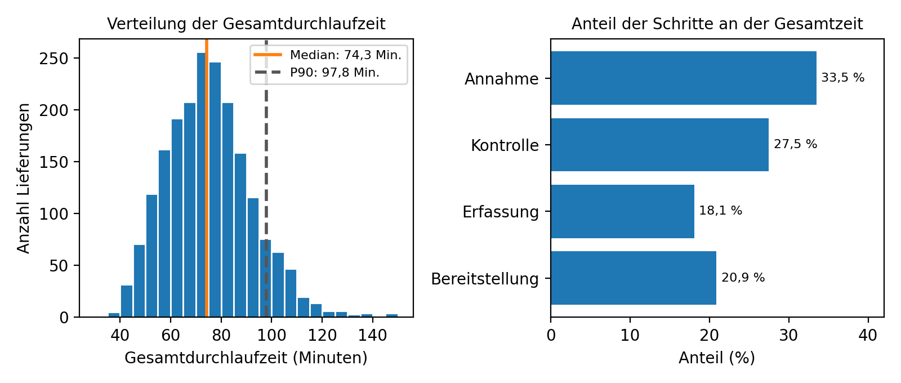
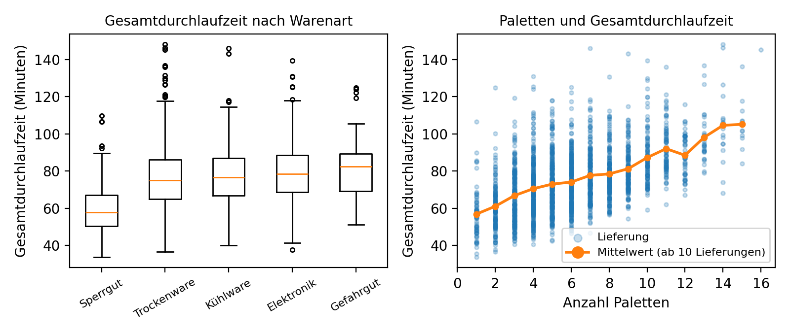

# Datenbasierte Analyse der Durchlaufzeiten im Wareneingang eines Logistikzentrums

Analysprojekt in Python: Auswertung von rund 2.100 Prozessdaten eines Wareneingangs, statistische Ermittlung von Verzögerungsursachen und wirtschaftlich bewertete Verbesserungsvorschläge.

**Kontext:** Übungsprojekt im Rahmen meiner Umschulung zum Fachinformatiker für Daten- und Prozessanalyse. Das Unternehmen (MainLogistik GmbH) und alle Daten sind synthetisch; personenbezogene Daten sind nicht enthalten.

## Ausgangslage

Im Wareneingang fallen täglich Prozessdaten an: Zeitstempel für jeden Prozessschritt (Ankunft, Annahme, Kontrolle, Erfassung, Bereitstellung) sowie Angaben zu Lieferant, Warenart, Paletten- und Positionsanzahl. Diese Daten wurden bisher nicht zusammenhängend ausgewertet – welche Schritte die Durchlaufzeit verlängern und warum, war nur schwer erkennbar.

## Ziel

1. Durchlaufzeiten der Prozessschritte messen und Kennzahlen berechnen
2. Ursachen für lange Durchlaufzeiten statistisch belegen (nicht nur vermuten)
3. Verbesserungsvorschläge entwickeln und nach Nutzen und Wirtschaftlichkeit bewerten (Kosten-Nutzen-Betrachtung, Amortisation)

## Vorgehen

Wasserfallmodell mit neun Phasen (Analyse → Planung → Datenvorbereitung → Datenanalyse → Auswertung → Optimierung → Qualitätssicherung → Projektabschluss → Dokumentation), Gesamtumfang 40 Stunden.

**Datenaufbereitung** – sechs Qualitätsregeln (doppelte Zeilen, fehlende Zeitstempel, falsche Reihenfolge, unmögliche Palettenzahl, Ausreißer, einheitliche Schreibweisen): 89 von 2.109 Zeilen entfernt (4,2 %), 42 Schreibweisen korrigiert → 2.020 auswertbare Lieferungen. Die Originaldaten blieben unverändert (MD5-Prüfung).

**Statistische Verfahren**

- Spearman-Korrelation für Zahlenmerkmale (robust gegenüber Ausreißern)
- Kruskal-Wallis-Test für Gruppenvergleiche (Lieferant, Warenart, Wochentag, Voranmeldung)
- Multiple lineare Regression (OLS) mit Dummy-Variablen; Modellwahl über VIF und R²

**Qualitätssicherung** – 11 automatisierte Tests am Ende des Notebooks, darunter Unverändertheit der Rohdaten (MD5), Plausibilitätsgrenzen, Nachrechnung aller Kennzahlen und Koeffizienten mit NumPy, Validierung des Regressionsmodells an 20 % Testdaten und ein Wiederholbarkeitstest des gesamten Laufes. Alle Tests bestanden.

## Wichtigste Ergebnisse

| Kennzahl | Wert |
| --- | --- |
| Gesamtdurchlaufzeit – Median | 74,3 Minuten |
| Gesamtdurchlaufzeit – Mittelwert | 75,3 Minuten |
| P90 (90 % der Lieferungen sind schneller) | 97,8 Minuten |
| Größter Zeitblock | Annahme (33,5 %) + Kontrolle (27,5 %) = 61 % der Gesamtzeit |

Regressionsmodell (R² = 0,581): Jede zusätzliche Palette kostet +2,4 Minuten, Gefahrgut +21,0 Minuten gegenüber Trockenware, eine fehlende Voranmeldung +7,3 Minuten, der Lieferant LF07 +9,2 Minuten gegenüber LF01 (jeweils p < 0,001; Signifikanzniveau 5 %).

Drei Verbesserungsvorschläge – Voranmeldung mit Zeitfenster, Ursachenklärung bei zwei auffälligen Lieferanten, Entlastung des Montags – sparen zusammen 2,0 bis 4,0 Minuten je Lieferung bzw. 445 bis 891 € pro Monat. Die Gesamtkosten (Projekt + Umsetzung, 1.852 €) sind nach 4,2 bis 2,1 Monaten amortisiert.





## Repository-Struktur

```
├── 01_Rohdaten/
│   └── wareneingang_roh.csv           # Rohdaten: 2.109 Zeilen (wird nie verändert)
├── 02_Notebook/
│   └── analyse_wareneingang.ipynb     # vollständige Analyse inkl. Tests
├── 03_Ergebnisse/
│   ├── wareneingang_bereinigt.csv     # bereinigte Daten inkl. abgeleiteter Merkmale
│   ├── datenfehler_liste.csv          # entfernte Zeilen mit Fehlergrund
│   ├── kennzahlen_gesamt.csv          # Kennzahlen der Gesamtdurchlaufzeit
│   ├── kennzahlen_schritte.csv        # Zeiten und Anteile der vier Schritte
│   ├── median_je_gruppe.csv           # Median je Lieferant, Warenart, Wochentag
│   ├── spearman.csv                   # Korrelationen (Zahlenmerkmale)
│   ├── kruskal_wallis.csv             # Gruppenvergleiche (Kategorien)
│   ├── regression_koeffizienten.csv   # Wirkung jedes Merkmals in Minuten
│   ├── vif.csv                        # Multikollinearitätsprüfung
│   ├── verbesserungen.csv             # Maßnahmen mit Kosten, Nutzen, Amortisation
│   ├── abb3_verteilung_schritte.png
│   └── abb4_warenart_paletten.png
├── 04_Dokumentation/
│   └── datenfluss_wareneingang.drawio # Datenfluss-Diagramm (draw.io-Quelle)
├── requirements.txt
├── .gitignore
└── README.md
```

## Ausführung

```bash
# Benötigte Pakete installieren
pip install -r requirements.txt

# Jupyter Notebook starten
jupyter notebook
```

Anschließend `02_Notebook/analyse_wareneingang.ipynb` öffnen und **Restart Kernel and Run All Cells** ausführen. Das Notebook läuft vollständig von oben nach unten, prüft die Datenqualität, berechnet alle Kennzahlen und Tests und erzeugt die Ergebnisdateien neu. Die Ordnernamen im Repository entsprechen genau den Pfaden im Notebook – die Analyse läuft daher unverändert. Getestet mit Python 3, pandas/NumPy/SciPy/statsmodels/Matplotlib in aktuellen Versionen (siehe `requirements.txt`).

## Hinweise

- Alle Daten sind synthetisch und enthalten keine personenbezogenen Angaben.
- Die Originaldaten werden vom Notebook nie verändert; die Analyse ist vollständig reproduzierbar.
- Verwendete KI-Hilfsmittel sind im Notebook offengelegt.

## Autor

**Vladimir Larionov** — Fachinformatiker für Daten- und Prozessanalyse (Umschulung)
